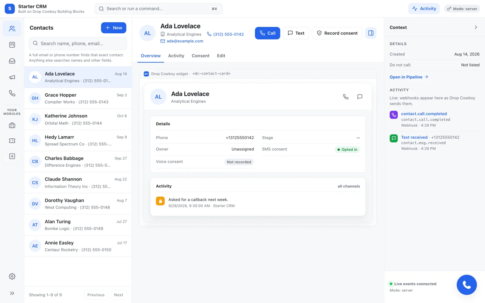
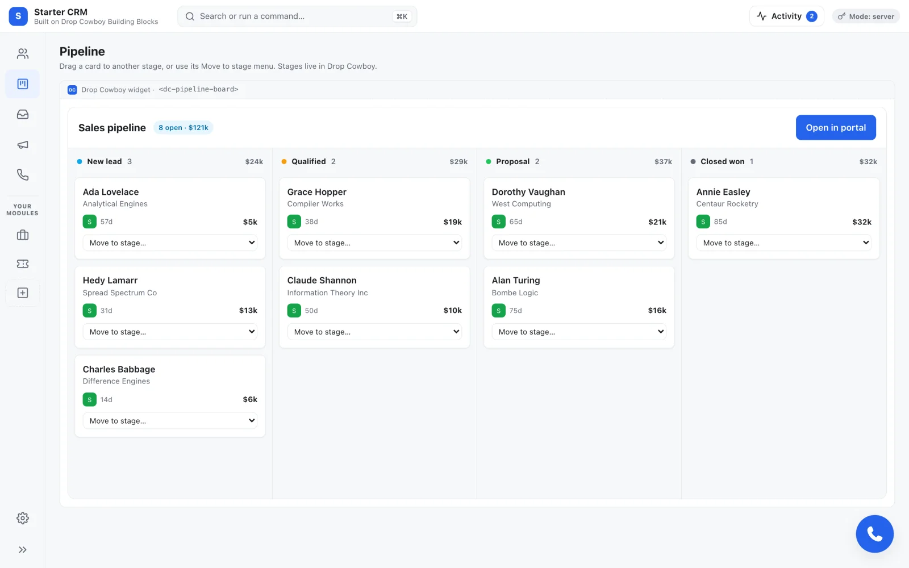
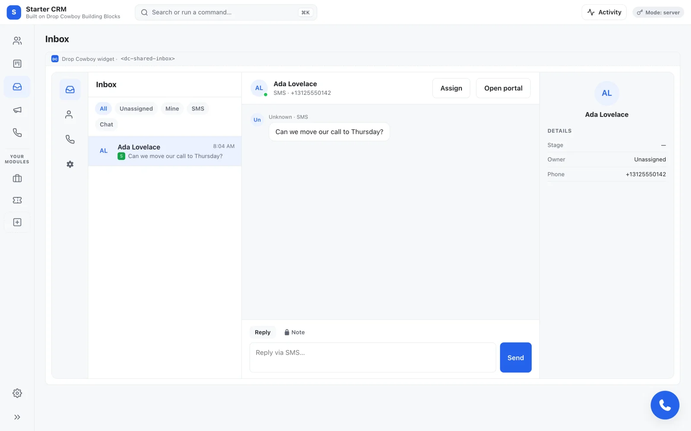

# Drop Cowboy Starter CRM

A working contacts CRM that you can copy and make your own. It calls and texts
from the browser, keeps a shared inbox, tracks deals on a pipeline board, and
shows what happens live. It's built on Drop Cowboy Building Blocks, and every
part is meant to be read, changed or thrown away.

<picture>
  <source media="(prefers-color-scheme: dark)" srcset="docs/screenshots/contact-dark.webp">
  
</picture>

It's for two kinds of people:

- **Developers** building a CRM, or adding calling and texting to one they
  already have.
- **People building with an AI assistant**, such as Cursor, Claude Code or
  Lovable, who want a working app to start from instead of a blank page.

## Call and text for free while you build

Every Drop Cowboy account can call and text **555 numbers**
(`+1 555 XXX XXXX`) for free. No real phone has the 555 area code, so nothing
you dial while building rings anyone. Save a contact with a 555 number, press
**Call**, and Drop Cowboy's test line answers. The last four digits pick what
happens:

| Last four | A call to it |
|---|---|
| `0001`, or anything not listed | answers, then hangs up after 30 seconds |
| `0002` | answers with a person speaking |
| `0003` | goes to voicemail |
| `0004` | rings for 30 seconds, then ends as no answer |
| `0005` | is busy |
| `0006` | fails, as an unreachable number would |
| `0007` | is declined |
| `0008`, `0009`, `0010` | answers and presses 1, 9 or 0 |

A text to a 555 number gets a reply a few seconds later: "sandbox got your
message: ..." followed by your text. You don't need a carrier, a phone number,
texting registration or funds for any of this. Use a number such as
`+1 555 555 0002`, not one starting `+1 555 000` to `+1 555 003`, which are
reserved.

## Choose how to start

| I want to... | Do this |
|---|---|
| See it running without installing anything | [Open it in GitHub Codespaces](#open-it-in-github-codespaces) |
| Build my own CRM with an AI assistant | [Build with an AI assistant](docs/build-with-ai.md) |
| Run it on my computer | [Run it on your computer](#run-it-on-your-computer) |
| Put it on the internet | [Hosting](HOSTING.md): Netlify, Vercel, Docker or AWS |

Whichever you pick, you need a Drop Cowboy account and an **API key**. Create
the key in the dashboard under
[**Developers > API Keys**](https://www.dropcowboy.com/app/#/api-keys): click
**Create API Key** and give it a name. API keys need a paid plan; on a free
trial the button is turned off. The secret is shown only once, so copy it
somewhere safe before you close the page. Calls and texts to 555 numbers stay
free on any plan.

## Open it in GitHub Codespaces

A Codespace is a computer in your browser that GitHub sets up for you. This
opens our copy, which is fine for trying it. To keep your changes, first make
your own copy (step 1 of [Run it on your computer](#run-it-on-your-computer))
and open a Codespace from that, with **Code > Codespaces**.

1. Click [**Open in GitHub Codespaces**](https://codespaces.new/Drop-Cowboy/starter-crm)
   and then **Create codespace**. Setup runs by itself and takes a few minutes.
2. Open the file `.env`. Replace both `replace-me` values with your API key
   and secret, then save.
3. In the terminal at the bottom, run `npm start`.
4. A message offers to open port 8080. Click **Open in Browser**.

You should see the Contacts page. Go on to [Make your first call](#make-your-first-call).

## Run it on your computer

You need [Node.js](https://nodejs.org) 24 or later. Check with `node -v`.

**1. Get your own copy.** On [GitHub](https://github.com/Drop-Cowboy/starter-crm),
click **Use this template > Create a new repository**. Then *clone* it, which
means download it to your computer with its history:

- In Cursor or VS Code, choose **Clone Git Repository** on the welcome screen
  and paste your new repository's address.
- Or, with the [GitHub command line tool](https://cli.github.com) (run
  `gh auth login` once first), make the copy and download it in one step:

```bash
gh repo create my-crm --template Drop-Cowboy/starter-crm --private --clone
cd my-crm
```

**2. Set it up.**

```bash
npm run setup
```

It asks four questions. Press Enter to keep the first answer (`server`) and
the last (a made-up user id), and paste your API key and secret for the other
two. The key and secret show on screen as you paste them, so don't do this
while sharing your screen. They're saved in a file called `.env`, which git
never commits. If you run setup again later, it first asks whether to replace
that `.env`; answer `y` to enter new settings, or press Enter to keep them.
Setup then installs what the server needs and ends with:

```text
Done. Next: npm start
```

**3. Start it.**

```bash
npm start
```

You should see:

```text
Starter CRM server (DC_AUTH_MODE=server, DC_ENV=development, DC_IDENTITY=dev) on http://127.0.0.1:8080
Events: DC_STORE=memory, DC_FANOUT=local, DC_WEBHOOKS=store
DROPCOWBOY_WEBHOOK_SECRET is not set, so webhooks will be refused with 503.
```

The last line is expected: the live Activity panel needs a webhook, which you
can add later ([Webhooks](docs/webhooks.md)). Everything else works without
one. Open <http://127.0.0.1:8080>.

If something goes wrong, open a second terminal in the same folder, leave the
server running, and run `npm run doctor`. It checks your settings, tries your
key against Drop Cowboy, and says what to fix.

## Make your first call

1. Click **Add a contact**. Give it any name and the phone number
   `+1 555 555 0002`, then click **Add contact**.
2. On the contact's page, click **Call**. The first time, the browser asks to
   use your microphone: click **Allow**, or the call can't start. The Dock,
   the phone panel at the side of the screen, places the call, and you hear a
   person speaking. Hang up whenever you like.
3. Click **Text** and send anything. The reply arrives in the
   [Inbox](#whats-inside) a few seconds later.

Nothing was charged. When you're ready to reach real phones, connect a carrier
and add funds in the dashboard; the Setup page lists what's left to do.

## What's inside

<table>
  <tr>
    <td width="50%"></td>
    <td width="50%"></td>
  </tr>
  <tr>
    <td>Pipeline: drag a card to change its stage.</td>
    <td>Inbox: texts and chats in one place.</td>
  </tr>
</table>

| Page | What you can do there |
|---|---|
| Contacts | List, search, add and edit contacts. Each one has Call, Text and Record consent buttons, and a timeline. |
| Pipeline | Move contacts between stages by dragging. |
| Inbox | Read and answer texts and web chats. |
| Campaigns | See your campaigns and how they're doing. |
| Phone | See your phone numbers, and rent a new one (it asks first). |
| Setup | A checklist of what your account still needs. |
| Deals | Track deals linked to contacts. Your server keeps them, and it's the example to copy for screens of your own. |
| Tickets | An empty page, waiting for the first screen you build. |

On every page, press ⌘K (Mac) or Ctrl+K (Windows) to find a contact, open a
page, or type "call" or "text" and a name. The app follows your system's light
or dark setting, and works on a phone.

It comes twice over, so you can pick what you know: the screens are written
once with no framework (`vanilla/`) and once in React (`react/`), and the server
once in Node (`server/node/`) and once in Python (`server/python/`).
[How it works](docs/how-it-works.md) explains the pieces.

## Next steps

| To... | Read |
|---|---|
| Change the name, logo and colours | [Customize: common changes](CUSTOMIZE.md#common-changes) |
| Let real people sign in | [Customize: choose who signs in](CUSTOMIZE.md#choose-who-signs-in) |
| See live activity and alerts, such as missed calls | [Webhooks](docs/webhooks.md) |
| Add a screen of your own | [Customize: add a module](CUSTOMIZE.md#add-a-module) |
| Put it on the internet | [Hosting](HOSTING.md) |
| Get it ready for real users | [Production checklist](PRODUCTION.md) |
| Understand how the parts fit | [How it works](docs/how-it-works.md) |
| Look up a word | [Glossary](docs/glossary.md) |
| Fix something | [Troubleshooting](TROUBLESHOOTING.md) |

Every page is listed in [`docs/`](docs/README.md).

## Run the tests

```bash
npm test
```

This runs every test, and none of them use your Drop Cowboy account or cost
anything. `npm run test:fast` skips the slower browser and container tests.
[How it works](docs/how-it-works.md#tests) lists each suite.

## Links

- [Drop Cowboy for developers](https://www.dropcowboy.com/developers): the API
  and Building Blocks docs
- [Drop Cowboy on GitHub](https://github.com/Drop-Cowboy/dropcowboy): API
  examples in Node, Python and C#, and the AI assistant setup
- [`AGENTS.md`](AGENTS.md): rules for AI assistants changing this starter
- [Changelog](CHANGELOG.md) and [Upgrading](UPGRADING.md)
- [Drop Cowboy Terms of Service](https://www.dropcowboy.com/terms)

MIT licensed. [`NOTICE`](NOTICE) explains what the license does not cover.
