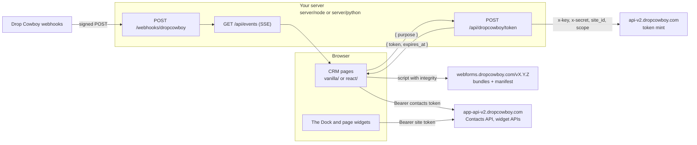

# How the Starter CRM works

This page is for anyone about to change the starter, or copy part of it into
an app of their own. It explains how the parts fit together. When you've read
it you'll know which file to open for any change, and why a page asks the
server for a token before it shows anything.

You don't need it to run the starter. For that, see the
[README](../README.md).

- [The big picture](#the-big-picture)
- [Three ways to build on Drop Cowboy](#three-ways-to-build-on-drop-cowboy)
- [Tokens, and why each page asks for one](#tokens-and-why-each-page-asks-for-one)
- [Pages and what each one uses](#pages-and-what-each-one-uses)
- [The shell around the pages](#the-shell-around-the-pages)
- [Test numbers and sandbox mode](#test-numbers-and-sandbox-mode)
- [How the browser gets a token: auth modes](#how-the-browser-gets-a-token-auth-modes)
- [Two servers, two front-ends](#two-servers-two-front-ends)
- [Settings](#settings)
- [Where things live](#where-things-live)
- [Tests](#tests)

## The big picture

There are three parties: the **browser**, **your server**, and **Drop Cowboy**.



In words:

1. A page asks your server for a token, naming what it's for (a **purpose**).
2. Your server asks Drop Cowboy for a short-lived **site token**, using your
   API key, and hands it back.
3. The page loads the Building Blocks scripts from Drop Cowboy's CDN and gives
   them the token. They call Drop Cowboy directly with it.
4. When something happens, such as a reply or a missed call, Drop Cowboy posts
   a signed **webhook** to your server. Your server checks the signature,
   stores the event and streams it to every open page.

What keeps this safe:

- **Your API key never leaves your server.** The server mints site tokens at
  `POST https://api-v2.dropcowboy.com/phone/public/embed/token`.
- **The browser holds only short-lived site tokens**, in memory, and calls
  `https://app-api-v2.dropcowboy.com` with them.
- **Widgets get their token as a JavaScript property** (`init({ token, getToken })`
  or `el.tokenManager`), never in an HTML attribute or a URL, where it could leak.
- **Scripts load from a pinned release** with Subresource Integrity hashes read
  from that release's `building-blocks-manifest.json`, so a changed script
  refuses to run.

## Three ways to build on Drop Cowboy

The starter uses all three, side by side, so you can see which suits you:

| Way | What it is | Where the starter uses it |
|---|---|---|
| **The headless Contacts API** | Plain HTTP calls from the browser, with a site token. You draw the screens. | The contacts list, search, the add and edit forms (`shared/contacts-api.js`) |
| **The Dock** | One script that adds calling, texting and an inbox to every page. | The Call and Text buttons (`shared/widgets.js`) |
| **Page widgets** | Web components such as `<dc-contact-card>` and `<dc-pipeline-board>`, for whole screens you'd rather not build. | The contact card, Pipeline, Inbox, Campaigns and Phone pages |

The [Building Blocks docs](https://www.dropcowboy.com/developers/building-blocks/dock)
describe each widget.

## Tokens, and why each page asks for one

The browser asks the server for a token by **purpose**. Only the server maps a
purpose to scopes, so a page can never ask for more than it needs:

| Purpose | Scopes | Needs a carrier and a balance |
|---|---|---|
| `session` | `["dialer:webrtc", "contacts"]` | Yes, except in [sandbox mode](#test-numbers-and-sandbox-mode) |
| `contacts` | `["contacts"]` | No |
| `campaigns` | `["campaigns"]`, read-only | No |
| `phone` | `["phone:hub"]`, which can rent numbers | Yes |

Because the contacts pages have their own `contacts` token, they keep working
for a team that hasn't connected a carrier or added funds yet. The Dock says
why calling is unavailable instead.

`shared/token-provider.js` keeps one token per purpose and reuses it while it
has more than a minute left. After that, the next request fetches a new one.

## Pages and what each one uses

| Page | Path | Built with | Token |
|---|---|---|---|
| Contacts | `/contacts` | The Contacts API: list and search, in a list beside every contact page | `contacts` |
| Add a contact | `/contacts/new` | The Contacts API: adds the contact, or opens the one that already has that number | `contacts` |
| Contact | `/contacts/:id` | The Contacts API to edit, delete and record consent; `<dc-contact-card>` with its timeline; The Dock for Call and Text | `contacts`, `session` |
| Pipeline | `/pipeline` | `<dc-pipeline-board>`. Drag a card, or use its Move to stage menu. | `contacts` |
| Inbox | `/inbox` | `<dc-shared-inbox>`, which borrows The Dock's session | `session` |
| Campaigns | `/campaigns` | The campaign hub, read-only | `campaigns` |
| Phone | `/phone` | `<dc-phone-hub>` and `<dc-number-picker>`. Renting a number asks first. | `phone` |
| Setup | `/setup` | The readiness checklist, the auth mode, the business number | none |
| Deals | `/modules/deals` | The Deals module's routes on your server, and `<dc-contact-card>` beside a deal | `contacts` |
| Tickets | `/modules/tickets` | A placeholder for your own screen | none |
| Every page | | The Dock, and live webhook activity | `session` |

Deals is a **module**: a screen of your own, with data your server keeps and
Drop Cowboy never sees. [Customize: add a module](../CUSTOMIZE.md#add-a-module)
shows how to make another.

## The shell around the pages

The app is laid out in regions, so you can keep the ones you want: a top bar,
the navigation, the contacts list, the page, and a context panel with the
contact's details and live activity. Each region's state is a data attribute
on `.app` (`data-nav`, `data-list`, `data-context`), and `shared/crm.css` lays
them out from those.

- **Command palette.** Press ⌘K or Ctrl+K, or use the search box in the top
  bar, to find a contact, open a page, or type `call` or `text` and a name to
  hand that contact to The Dock. It searches with the same `contacts` token
  as the list.
- **Embedded mode.** Add `?layout=embedded` to any address to drop the top bar
  and the navigation, for showing a page inside another product. Links keep
  the parameter, so the app stays embedded as you move around.
- **Theming.** Every colour is a `--crm-*` custom property in `shared/crm.css`.
  `--dc-primary-color` is set from `--crm-brand`, so the widgets take your
  brand colour too. The app follows the system's light or dark setting until
  someone picks one with the theme button, which the browser then remembers.
  `<html data-theme="dark">` or `"light"` overrides the system setting, and the
  widgets follow through their `data-dc-theme` attribute.
- **Your own screens.** The navigation lists `MODULES` in `shared/ui.js`.

## Test numbers and sandbox mode

Every account can call and text **555 numbers** (`+1 555 XXX XXXX`) for free,
and they never ring a real phone. The [README](../README.md#call-and-text-for-free-while-you-build)
has the table of what each one does, and Drop Cowboy's
[test numbers page](https://www.dropcowboy.com/developers/api/test-numbers)
has the full detail.

A few things the code relies on:

- **A text to a 555 number needs no business number.** With no sender given,
  Drop Cowboy sends it from a 555 number of its own. That's why `textContact`
  in `shared/widgets.js` asks for a business number only before texting a
  real number.
- **The reply arrives as an ordinary webhook**, `contact.msg.received`, with
  the text "sandbox got your message: ..." and your message.
- **A team with no carrier or no funds is in sandbox mode.** It still gets a
  `session` token, but that token reaches 555 numbers only. Anything else is
  refused with `sandbox_only` (403), and more than 5 test calls at once with
  `sandbox_concurrency`. The readiness check reports `"sandbox_only": true` and
  a `sandbox_only_reason` (`byoc_required` or `insufficient_balance`). Both
  front-ends then say so on the Setup page and under a contact's Call and Text
  buttons (`shared/sandbox.js`).

## How the browser gets a token: auth modes

`DC_AUTH_MODE` decides where tokens come from.

### `server` (the default, and the one to deploy)

Your server mints tokens with your API key. After `npm run setup`, `.env` has:

```bash
DC_AUTH_MODE=server
DC_ENV=development
DC_IDENTITY=dev
DROPCOWBOY_SITE_ID=<a generated UUID>
DROPCOWBOY_API_KEY=<your API key>
DROPCOWBOY_API_SECRET=<your API secret>
STARTER_CRM_USER_ID=<a UUID for the signed-in user>
```

`DC_IDENTITY` decides who the server believes is calling. `dev` makes every
visitor the user in `STARTER_CRM_USER_ID`, which is only safe on your own
computer, so `DC_ENV=production` refuses it. Before you deploy, pick one of:

```bash
DC_IDENTITY=passcode           # one shared passcode; also set DC_PASSCODE (12+ characters)
DC_IDENTITY=oidc               # Auth0, Clerk, Supabase, Firebase...; also set DC_OIDC_ISSUER and DC_OIDC_AUDIENCE
DC_IDENTITY=./my-identity.js   # your own session system
```

[Customize: choose who signs in](../CUSTOMIZE.md#choose-who-signs-in) has a
recipe for each, and [`providers/identity.md`](providers/identity.md) describes
the interface.

`DROPCOWBOY_SITE_ID` is one UUID per deployed app. Keep it: it separates this
app's inbox from any other, so a new one starts an empty inbox.

### `mcp-session` (building with an AI assistant, on your own computer)

Your AI assistant mints a token with the Drop Cowboy MCP server and writes it
to a file. The server hands that file to the browser, on this computer only.
No API key is involved. In `.env`:

```bash
DC_AUTH_MODE=mcp-session
DROPCOWBOY_SITE_ID=<the UUID you generated>
```

Ask the assistant to call `mint_embed_token` with that `site_id` and
`scope: ["dialer:webrtc", "contacts"]`, then write the result to
`.dropcowboy/session.json` in the starter's folder:

```json
{ "token": "<token from mint_embed_token>", "expires_at": 1790000000000, "site_id": "5a4b3c2d-1e0f-4a9b-8c7d-6e5f4a3b2c1d" }
```

`expires_at` is in epoch milliseconds, copied from the mint result, and git
ignores `.dropcowboy/`. When the token expires, ask the assistant to mint
again. The Campaigns and Phone pages need tokens of their own, so they're
unavailable in this mode, and production refuses it.
[Build with an AI assistant](build-with-ai.md) explains connecting the MCP
server.

### `login` (coming soon)

"Sign in with Drop Cowboy" will let you try the starter with your own Drop
Cowboy login and no API key. It isn't available yet, so the page says
"Sign-in is not set up yet". Use `server` until then.

## Two servers, two front-ends

The screens are written twice, so you can read the version you know:
`vanilla/` (no framework, no build step) and `react/` (React 19). Both use the
modules in `shared/`, so they differ only in how they draw.

The server is written twice too, with the same routes:
[`server/node/`](../server/node/README.md) (Express) and
[`server/python/`](../server/python/README.md) (Flask).
[`server/CONTRACT.md`](../server/CONTRACT.md) is what both follow, and the
conformance suite checks that they do. There are also variants for
[Next.js on Vercel](../server/nextjs/README.md) and
[Netlify functions](../server/netlify/README.md).

**Run the Python server** (after `npm run setup -- --python`):

```bash
cd server/python
source .venv/bin/activate
python -m starter_crm
```

In production it runs under Gunicorn:
`gunicorn -c gunicorn.conf.py starter_crm.wsgi:app`.

**Run the React front-end.** The servers serve `vanilla/` at `/`. For React:

```bash
cd react
npm install
npm run dev      # http://localhost:5173/react/, which forwards to the server on 127.0.0.1:8080
npm run build    # writes react/dist/, which the server serves at /react/
```

## Settings

Both servers read `.env` in the starter's folder, and anything already set in
your shell wins. [`.env.example`](../.env.example) lists every setting with a
comment, and [`server/CONTRACT.md`](../server/CONTRACT.md) is the final word.
The ones you'll meet first:

| Setting | What it does |
|---|---|
| `DC_AUTH_MODE` | `server` (default), `mcp-session` or `login`. See [auth modes](#how-the-browser-gets-a-token-auth-modes). |
| `DC_ENV` | `development` or `production`. Production refuses unsafe settings, such as `DC_IDENTITY=dev`. |
| `DROPCOWBOY_SITE_ID` | One UUID per deployed app. Keep it. |
| `DROPCOWBOY_API_KEY`, `DROPCOWBOY_API_SECRET` | Your API key, with the `numbers:write` and `balance:read` scopes. Secret. |
| `DC_IDENTITY`, `DC_PASSCODE`, `DC_OIDC_*` | Who signs in. See [Customize](../CUSTOMIZE.md#choose-who-signs-in). |
| `STARTER_CRM_USER_ID` | The user id everyone gets with `DC_IDENTITY=dev`. |
| `DROPCOWBOY_WEBHOOK_SECRET` | The signing secret of each webhook, separated by commas. Secret. See [Webhooks](webhooks.md). |
| `DC_PUBLIC_URL`, `DC_TRUST_PROXY` | The app's public address, and `1` behind one proxy or load balancer. |
| `DC_STORE`, `DC_DATA`, `DC_FANOUT`, `DC_WEBHOOKS` | Where events and module data are kept, and how they move. The defaults suit one server; [Hosting: a database](../HOSTING.md#a-database) covers more. |
| `DC_SECRETS` | Read secrets from a file or a secret manager instead of `.env`. See [`providers/secrets.md`](providers/secrets.md). |
| `DC_CDN_VERSION` | Pins the Building Blocks release, such as `3.33.16`. `latest` is refused, because the integrity hashes need a fixed release. |
| `HOST`, `PORT` | Default `127.0.0.1` and `8080`. |

## Where things live

```text
starter-crm/
  .env.example         Every setting, with comments. Copy to .env, or run npm run setup.
  vanilla/             The CRM with no framework and no build step.
  react/               The same CRM in React 19.
  shared/              Code both front-ends use.
    crm.js             startCrm(): settings, tokens, the CDN loader, the Contacts API, The Dock.
    token-provider.js  One token per purpose: reuse and refresh.
    contacts-api.js    The headless Contacts API client.
    deals-api.js       The Deals module's client, the example for your own.
    dropcowboy-cdn.js  Loads the Building Blocks from the CDN, with integrity checks.
    widgets.js         Hands tokens to widgets; Call, Text, the inbox, the hubs.
    sandbox.js         555 test numbers and sandbox mode.
    errors.js          Every error code, in plain language.
    events.js          Webhook events, streamed to the page.
    activity.js        The live activity list.
    ui.js              Navigation, layout, theme, the command palette, MODULES.
    crm.css            How both front-ends look: colours, regions, components.
    setup.js           The readiness checklist.
  server/
    CONTRACT.md        What every server implementation does.
    node/              The Express server.
    python/            The Flask server.
    nextjs/, netlify/  The same server for Vercel and Netlify.
    schemas/           What each module route accepts. Both servers read these.
    migrations/        Database changes, for the SQL stores.
    conformance/       One HTTP test suite that every server passes.
  docs/                These pages, and providers/ for each replaceable piece.
  deploy/aws/          The AWS template npm run deploy:aws uses.
  scripts/             setup, start, doctor, new:module and the deploy commands.
  tests/               The test runner and the browser tests.
```

Each folder has a README with more detail: [`shared`](../shared/README.md),
[`vanilla`](../vanilla/README.md), [`react`](../react/README.md),
[`server/node`](../server/node/README.md), [`server/python`](../server/python/README.md),
[`server/conformance`](../server/conformance/README.md) and [`tests`](../tests/README.md).

## Tests

```bash
npm test         # everything
npm run test:fast   # skips the browser and container tests
```

None of the tests use your Drop Cowboy account or cost anything. The servers
run against a local copy of the Drop Cowboy API, and the browser tests run
both front-ends against a fake Drop Cowboy. [`tests/README.md`](../tests/README.md)
lists every stage, how to run one on its own, and how the fakes work.
